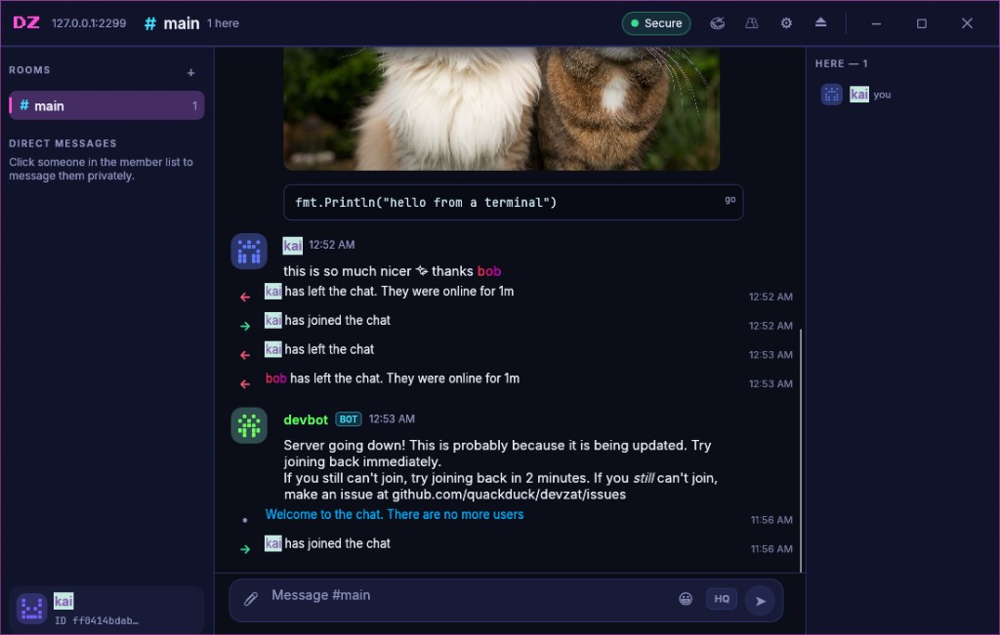

<div align="center">


# Devzat

**Chat over SSH, now with a desktop app.**
</div>

Devzat is an SSH server that drops you into a chat room instead of a shell. There are SSH apps on every platform, phones included, so anyone can join from anywhere. Your SSH key is your identity: no accounts, no passwords.

> **This is a fork** of [quackduck/devzat](https://github.com/quackduck/devzat), the original project by [Ishan Goel](https://github.com/quackduck). It adds a desktop client for Linux and Windows, timestamps, chat history that survives reconnects, picture sharing, and some cleanup and security fixes. See [What this fork adds](#what-this-fork-adds).



## Contents

- [What this fork adds](#what-this-fork-adds)
- [The desktop client](#the-desktop-client)
- [Joining from a terminal](#joining-from-a-terminal)
- [Hosting a server](#hosting-a-server)
- [Commands](#commands)
- [Integrations and plugins](#integrations-and-plugins)
- [Credits and license](#credits-and-license)

## What this fork adds

- **A desktop client** for Linux and Windows, built in Rust with egui. Desktop and terminal users share the same rooms.
- **Timestamps on every message**, shown in your own time zone, with 12-hour, 24-hour, or relative ("5m ago") times.
- **24 hours of room history**, replayed when you join, even after you disconnect or the server restarts. The window is configurable.
- **Pictures**: paste or drop an image, or send a link that ends in `.png`, `.jpg`, `.gif`, or `.webp`. Pictures keep devzat's pixelated terminal look by default; put `!hq` in front for a sharp one.
- **Security fixes**: the server's private host key is created readable only by its owner, and picture links can't make the server reach its own private network (such as a cloud metadata service).
- **Removed**: the profanity filter, the `pronouns` command, and the non-working `theme` command.

The public server at `devzat.hackclub.com` runs the original project, so the desktop client can't connect there. Point it at a server running this fork.

## The desktop client

The desktop app connects to a devzat server over SSH, the same way a terminal does, then talks to it through a dedicated channel so it can show real chat bubbles, pictures, and a member list.

- Rooms, direct messages, a member list, mentions, and unread badges
- Markdown, code blocks with a copy button, clickable links, and devzat's colored names
- Paste, drag, or attach pictures; send them retro or sharp (HQ); click any picture to view it full size
- `/` opens a command picker, `@` completes names, and there's an emoji picker
- Four themes (Neon, Phosphor, Sunset, Paper), optional CRT scanlines, and confetti
- Checks the server's host key with an OpenSSH-style fingerprint and randomart, and warns loudly if it changes
- Reconnects on its own if the network drops
- A borderless window: drag the top bar to move it, double-click to maximize, resize from any edge

### Build it

You need Rust 1.95 or newer. Install it from [rustup.rs](https://rustup.rs).

**Linux**

```sh
git clone https://github.com/Teach2Breach/devzat
cd devzat/desktop
cargo build --release
./target/release/devzat-desktop
```

It runs on X11 or Wayland with any working Vulkan or OpenGL driver.

**Windows**

Install Rust with the default (MSVC) toolchain, then in PowerShell or a Command Prompt:

```powershell
git clone https://github.com/Teach2Breach/devzat
cd devzat\desktop
cargo build --release
.\target\release\devzat-desktop.exe
```

The `.exe` is a single file with no extra DLLs, so you can copy it anywhere.

**Windows build from Linux**

```sh
rustup target add x86_64-pc-windows-gnu
sudo apt install mingw-w64
cd devzat/desktop
cargo build --release --target x86_64-pc-windows-gnu
```

The result is `target/x86_64-pc-windows-gnu/release/devzat-desktop.exe`.

### Use it

1. **Connect.** Enter the server address, its port (`2221` unless the admin changed it), and a display name, then press Connect.
2. **Check the server's key.** The first time, the app shows the server's fingerprint. Compare it with what the admin gives you; they can print it with `ssh-keygen -lv -f devzat-sshkey`. Then choose "Trust & connect". If the key ever changes, the app stops and warns you.
3. **Pick your identity.** The app makes its own SSH key on first run. To keep the same name, color, and admin rights you have in the terminal, use "Change key" on the launch screen and choose your existing key, such as `~/.ssh/id_ed25519`. "Copy ID" copies the ID an admin needs for a private server's allowlist.
4. **Chat.** Enter sends and Shift+Enter starts a new line. Type `/` for commands or `@` for names. Click a person in the member list to message them privately, and use `+` next to Rooms to join or create a room.
5. **Share pictures.** Paste with Ctrl+V, drag a file onto the window, or use the paperclip. Turn on HQ to send them sharp. To see every picture sharp, turn off "Retro pixel pictures" in Settings.

The app keeps its key, trusted server keys, and settings in `~/.local/share/devzat-desktop/` on Linux and `%APPDATA%\devzat-desktop\` on Windows. More detail is in [desktop/README.md](desktop/README.md).

## Joining from a terminal

```sh
ssh -p 2221 yourname@chat.example.com
```

The first time you join, your SSH username becomes your display name. Change it later with `nick`. To make joining shorter, add this to `~/.ssh/config`:

```ssh-config
Host chat
    HostName chat.example.com
    Port 2221
    User yourname
```

Then `ssh chat` is enough.

Things to try once you're in:

- `cd` lists rooms, `cd #name` joins or creates one, and `cd ..` goes back to `#main`
- `=name hello` sends a private message
- Markdown works, including code fences. Use `\n` for a new line
- `tz America/Chicago` (add `24h` for a 24-hour clock) sets your time zone, and plain `tz` switches to relative times
- `history` shows the room's last 24 hours again
- A picture link shows as a picture. `!hq <link>` sends a sharp one, and `gfx` picks how sharp pictures draw in your terminal (Kitty, iTerm2, sixel, or blocks)
- `:rocket:` becomes 🚀, and `tic` and `hang` start games

If you see `Permission denied (publickey)`, you don't have an SSH key yet. Make one with `ssh-keygen -t ed25519`. On servers that aren't private, you can also join without a key on the second port (`8080` by default).

## Hosting a server

You need Go 1.24 or newer.

```sh
git clone https://github.com/Teach2Breach/devzat && cd devzat
go build -o devzat .
./devzat
```

On first run, devzat writes a default `devzat.yml` and a host key, then listens on port 2221. Set `PORT` to use another port. The config includes, among other settings:

```yaml
port: 2221
alt_port: 8080        # keyless logins, only on servers that aren't private
history_hours: 24     # how much room history to keep and replay
data_dir: devzat-data # bans, saved names, history, uploaded pictures
key_file: devzat-sshkey
private: false        # true limits the server to the allowlist below
allowlist: {}         # ID: note, for each person allowed on a private server
admins: {}            # ID: note, for each admin
```

Desktop users need nothing extra on the server; the desktop channel is always available. They go through the same bans, allowlist, and rate limits as everyone else.

devzat also serves Go's profiler on `profile_port` (5555 by default). Keep that port closed to the internet.

**Upgrading from the original devzat?** Delete the `censor:` line from your config; this fork no longer has that setting and won't start with it. Also run `chmod 600 devzat-sshkey`, because older versions created the key readable by other users.

The [Admin's Manual](Admin's%20Manual.md) covers admins, private servers, integrations, and more.

## Commands

Run `cmds` in the chat for the main list and `rest` for the others. `man <command>` explains one in detail.

```text
=<user>  <msg>             DM <user> with <msg>
users                      List users
color    <color>           Change your name's color
exit                       Leave the chat
help                       Show help
man      <cmd>             Get help for a specific command
emojis                     See a list of emojis
bell     on|off|all        Ring the terminal bell on pings, never, or for every message
clear                      Clear the screen
hang     <char|word>       Play hangman
tic      <cell num>        Play tic tac toe
devmonk                    Test your typing speed
cd       #room|user        Join a room, DM someone, or list rooms
tz       <zone> [24h]      Set your time zone for timestamps
history                    Replay this room's saved messages
gfx      <mode>            How sharp pictures are drawn: auto, blocks, kitty, iterm, sixel
nick     <name>            Change your display name
prompt   <prompt>          Change your prompt
rest                       Uncommon commands
cmds                       Show this list
```

```text
bio      [user]               Show someone's bio, or set yours
id       <user>               Show someone's ID (a hash of their key)
admins                        List admin IDs
eg-code  [big]                Example of syntax-highlighted code
lsbans                        List banned IDs
ban      <user> [reason] [dur]  Ban someone (admin)
unban    <IP|ID>              Unban someone (admin)
mute     <user>               Mute someone (admin)
unmute   <user>               Unmute someone (admin)
kick     <user>               Kick someone (admin)
art                           Panda art
pwd                           Show your current room
shrug                         ¯\_(ツ)_/¯
uname                         Show build info
uptime                        Show server uptime
8ball    <question>           Always tells the truth
rmdir    #room                Remove an empty room
logs     [lines]              Show server logs (admin)
```

Tip: `kick` can clear out your own old session if it's stuck after a dropped connection.

## Integrations and plugins

A self-hosted server can bridge a room to Slack and post join announcements to Twitter. Discord bridging and other extras are available as plugins built on devzat's gRPC [plugin API](plugin/README.md). The [Admin's Manual](Admin's%20Manual.md) explains how to set these up and lists known plugins.

## Credits and license

Devzat was created by [Ishan Goel](https://github.com/quackduck) with ideas and code from many contributors. Thanks to [Hack Club](https://hackclub.com) and [Caleb Denio](https://github.com/cjdenio) for hosting the original public server. For the original project and its history, see [quackduck/devzat](https://github.com/quackduck/devzat).

Devzat is MIT licensed; see [LICENSE](LICENSE). The desktop client's dependencies use permissive licenses such as MIT, Apache-2.0, and BSD, and its bundled fonts use the SIL Open Font License. Details are in [desktop/README.md](desktop/README.md).

A Chinese translation of the original README is in [README-CN.md](README-CN.md). It doesn't cover this fork's additions.
